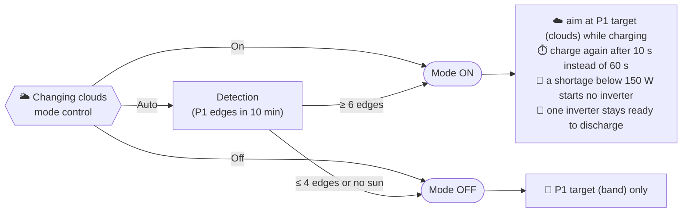

# Zendure HA-GP013

[![HACS Custom][hacs-badge]][hacs-add]
[![Release][release-badge]][release]
[![Home Assistant][ha-badge]](hacs.json)
[![License][license-badge]](LICENSE)

**Zero at the meter with Zendure batteries: follows your P1 meter every second, runs as few inverters as needed and is easy on your hardware.**

Zendure HA-GP013 steers Zendure SolarFlow, Hyper, Hub, AIO and Ace devices toward 0 W at the grid connection (*nul op de meter*). It replaces [Zendure-HA](https://github.com/Zendure/Zendure-HA) and keeps your devices, entities and settings.

> Not an official Zendure product.

## Added value over the standard integration: Zendure-HA

| | Zendure-HA | Zendure HA-GP013 |
|---|---|---|
| P1 meter | HA sensor, about every 5 s with HomeWizard | **HomeWizard read directly, every second** (API v2 WebSocket or v1), sensor as fallback |
| Peaks (kettle, hob) | Next control cycle | **New cycle at once** from a 400 W jump; running inverters follow every P1 update |
| Changing clouds | No special handling | **Detected** (or set by hand): aims at a small export, shorter charge delay, one inverter kept ready |
| Several inverters | Spread over all | **As few as needed** (e.g. 3000 W on 2, 1500 W on 1), charge and discharge **roles**, swap only after a clear SoC difference |
| Hardware | | Commands to RAM (flash at most once per hour), confirmed 0 W on every change of direction, minimum run time, **idle inverters sleep** (≈30 W → 5 W) |
| Robustness | | Follows devices to new IP addresses, safe fallback without P1, **recognises a battery (BMS) limit**, Repairs issue when another controller changes the limits, watchdog |
| Insight | | One options menu, diagnostics per inverter, P1 + control state recording, replayable simulation |

In the simulation (three SolarFlow 2400 AC+, measured ramp and latency) this gives about **58 % less grid import with changing clouds** than Zendure-HA 1.4.4. Every change to the control logic is measured this way; see [Simulation](docs/simulation.md) and [CHANGES.md](CHANGES.md).

Changes in Zendure-HA (new devices, protocol fixes) are taken over where they fit; the latest is noted in [CHANGES.md](CHANGES.md).

## What's new in 1.6.9

- 🌥️ **Changing clouds mode by hand**: *Auto*, *On* or *Off*, with its own **P1 target (clouds)**.
- 🔋 **Battery limits are recognised**: when the BMS gives less than asked (a charge that tapers near full, a cold battery), the other inverters take over the rest.
- 🤫 **Fewer commands**: power tolerance 15 W by default and a calm manual mode (20–30 % fewer commands in the replayed evenings, same result at the meter).
- 🐕 **No false watchdog warning** when all inverters run at their limit.

Details in [CHANGES.md](CHANGES.md).

## Installation

[![Open in HACS][hacs-open-badge]][hacs-add]

1. HACS → ⋮ → *Custom repositories* → add `https://github.com/GruttePier013/Zendure-HA-GP013`, type *Integration*.
2. Download **Zendure HA-GP013** and restart Home Assistant.
3. New installation: 

**Coming from Zendure-HA?** Both use the domain `zendure_ha`, so they cannot run side by side. Follow [Switching from Zendure-HA](docs/migration.md): your settings and entities stay.

Requirements: Home Assistant 2025.4 or newer, a [Zendure app token](https://github.com/Zendure/Zendure-HA/wiki/Installation), and for smart matching a P1 power sensor (W) or a HomeWizard P1 meter.

## Configuration at a glance

There are two places to set things:

| Where | What | When you use it |
|---|---|---|
| 🎛️ **Device page of the *Zendure Manager*** (*Settings → Devices & services → Zendure HA-GP013 → Zendure Manager*) | The mode and the targets: entities you can put on a dashboard or change from an automation | Daily |
| ⚙️ **Options menu** (*… → Zendure HA-GP013 → Configure*) | How the control works | Once, at setup |

### 🎛️ Zendure Manager: controls and configuration

| | Entity | Values | What it does |
|---|---|---|---|
| 🔀 | **Operation mode** | Off · Manual power · Smart matching · Smart discharge only · Smart charge only · Store solar | *Smart matching* keeps the meter at 0 W in both directions. *Discharge only* / *charge only* do one direction. *Store solar* only charges from surplus. *Manual power* runs a fixed power. |
| ✋ | **Manual power** | −12000 … +12000 W | The power in *Manual power* mode: **+** discharges into the house, **−** charges. Shared over the inverters by SoC; a share only moves when it changes more than 5 % of this value. |
| 🎯 | **P1 target (band)** | −200 … +200 W, default 0 | The P1 value the control aims at. **0**: zero at the meter. **−50**: up to 50 W export is fine while charging or idle (fewer commands). **+50**: up to 50 W import is fine while discharging. |
| 🌥️ | **Changing clouds mode control** | Auto · On · Off | **Auto**: the manager detects changing clouds itself. **On** / **Off**: you decide, and the manager does not switch it until you choose *Auto* again. |
| ☁️ | **P1 target (clouds)** | 0 … −500 W, default −100 | The export the control aims at while charging in the changing clouds mode, so a passing cloud costs a little export instead of import. At most the recent sun surplus; 0 on a day the batteries will not be full (solar forecast). |

The binary sensor 🌥️ **Changing clouds mode** (diagnostic) shows whether the mode is on now, with the attributes `source` (`auto` / `user`) and `detected` (what the detection says, also while you overrule it).

Both targets work together: the **band** always applies; in the changing clouds mode the **clouds** target applies too, and the larger export counts (they do not add up).

### ⚙️ Options menu

<b>⚡ Power control</b>: how fast and how sensitive the manager follows the P1 meter

| Setting | Default | What it does | Tip |
|---|---|---|---|
| ⏱️ Normal update interval | 4 s | A control cycle at least this often | 4–5 s is enough: peaks and the fast adjustment react between cycles |
| ⚡ Fast update interval | 2.2 s | The next cycle after a clear P1 change | Shorter gives more commands, hardly less import |
| 📈 Minimum P1 change | 15 W | Smaller P1 changes are not a "clear change" | |
| ▶️ Minimum power to start a device | 50 W | A stopped inverter starts only for at least this much | |
| 🎚️ Device power tolerance | **15 W** | A new command only when it differs more than this from the measured power | The inverters follow within about ±5 W; with 5 W the control chases that noise (16 November: 29 % of the commands were steps below 15 W) |
| ✋ Update interval in manual mode | 15 s | How often *Manual power* is checked | No need to make it long: an unchanged share sends nothing |
| 🏔️ Peak shaving limit | 0 W (off) | The batteries only discharge above this import | |
| 🚀 Peak detection | 400 W | A P1 jump this big (a kettle on, or off while discharging) starts a cycle at once | 0 = off |

<b>🔄 Direction change</b>: protection of the relays

| Setting | Default | What it does |
|---|---|---|
| ⏸️ Delay before a change of direction | 6 s | Between charging and discharging the inverter always passes 0 W; without a measured 0 W it waits this long |
| ⏳ Minimum run time | 10 s | A started inverter keeps a low power this long, so a short dip does not make the relay chatter |

<b>🔋 Multiple inverters</b>: spread, roles, flash and sleep

| Setting | Default | What it does | Tip |
|---|---|---|---|
| 📊 Spread threshold | 85 % | Another inverter starts only when the running ones carry this share of their limit | 85 %: one SolarFlow 2400 up to about 2000 W, the others stay ready for peaks |
| 🔁 Role switch margin | 10 % | One inverter is ready to charge, one to discharge; a role moves only when another leads by this much SoC (and after 5 min) | |
| 💾 Safe state in flash | on | Stores 0 W once in the flash, so a rebooted inverter starts at 0 W (at most once per hour) | |
| 😴 Sleep when idle | 10 min | An idle inverter sleeps after this long at 0 W (≈30 W → 5 W); 0 = off | The discharger stays awake |
| 🕐 Ready hours | empty (always) | Hours the discharger is kept awake, e.g. `7-9, 12-13, 17-19` | Outside them it may sleep too |

<b>☀️ Solar forecast</b>, <b>📟 P1 meter</b>, <b>📡 MQTT</b>, <b>🏷️ Device addresses</b>, <b>🧪 Logging</b>

| Menu | What it sets |
|---|---|
| ☀️ Solar forecast | Optional sensor with today's forecast (e.g. Solcast). On a day the batteries will not be full, no export on purpose; with no more sun, the charger is made ready to discharge. |
| 📟 P1 meter | The P1 sensor, and optionally the IP address of a HomeWizard P1 meter that is read every second |
| 📡 Account and MQTT | Zendure app token; cloud or local MQTT broker |
| 🏷️ Device addresses | A fixed IP address per zenSDK inverter |
| 🧪 Logging, simulation and test data | MQTT logging, simulation log, a recording of P1 and the control every second ([Recording](docs/recording.md)) |

More detail per setting: [Configuration](docs/configuration.md).

## Supported devices

Ace 1500, AIO 2400, Hyper 2000, Hub 1200, Hub 2000, SolarFlow 800 / 800 Pro / 800 Pro2 / 800 Plus, SolarFlow 1600 AC+, SolarFlow 2400 AC / AC+ / Pro, SuperBase V6400 (untested). SuperBase V4600 is not supported via the token yet. Developed on three SolarFlow 2400 AC+ on zenSDK with a local MQTT broker.

## Documentation

- [Configuration](docs/configuration.md): all settings, P1 target, solar forecast, HomeWizard
- [Switching from Zendure-HA](docs/migration.md): keep your settings, HACS
- [Recording and diagnostics](docs/recording.md): P1/control recording, events, watchdog
- [Simulation](docs/simulation.md): compare and replay
- [CHANGES.md](CHANGES.md): what changed per version
- Zendure-HA wiki, also valid here: [fuse groups](https://github.com/Zendure/Zendure-HA/wiki/Fuse-Group), [local MQTT](https://github.com/Zendure/Zendure-HA/wiki/Local-Mqtt-(Legacy-Devices)), [Hyper 2000](https://github.com/Zendure/Zendure-HA/wiki/Troubleshooting)

## Problems and contributing

Open an [issue][issues] with *Download diagnostics* from the integration page attached (secrets and serials are redacted). Please do not report problems with this integration to Zendure-HA.

Pull requests are welcome. Tests: `pytest` with `requirements_test.txt`. Changes to the control logic come with a run of `scripts/compare_smart_mode.py`.

## Origin and thanks

Started from [Zendure-HA](https://github.com/Zendure/Zendure-HA) 1.4.4 by [fireson](https://github.com/fireson) and contributors, whose device and protocol work is the foundation of this project. Thank you! 

MIT License, see [LICENSE](LICENSE); the copyright notice of Zendure-HA is kept.

[hacs-badge]: https://img.shields.io/badge/HACS-Custom-41BDF5?style=for-the-badge&logo=homeassistantcommunitystore&logoColor=white
[hacs-open-badge]: https://my.home-assistant.io/badges/hacs_repository.svg
[hacs-add]: https://my.home-assistant.io/redirect/hacs_repository/?owner=GruttePier013&repository=Zendure-HA-GP013&category=integration
[release-badge]: https://img.shields.io/github/v/release/GruttePier013/Zendure-HA-GP013?style=for-the-badge
[release]: https://github.com/GruttePier013/Zendure-HA-GP013/releases
[ha-badge]: https://img.shields.io/badge/Home%20Assistant-2025.4%2B-18BCF2?style=for-the-badge&logo=homeassistant&logoColor=white
[license-badge]: https://img.shields.io/github/license/GruttePier013/Zendure-HA-GP013?style=for-the-badge
[issues]: https://github.com/GruttePier013/Zendure-HA-GP013/issues
